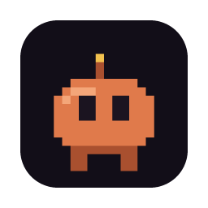
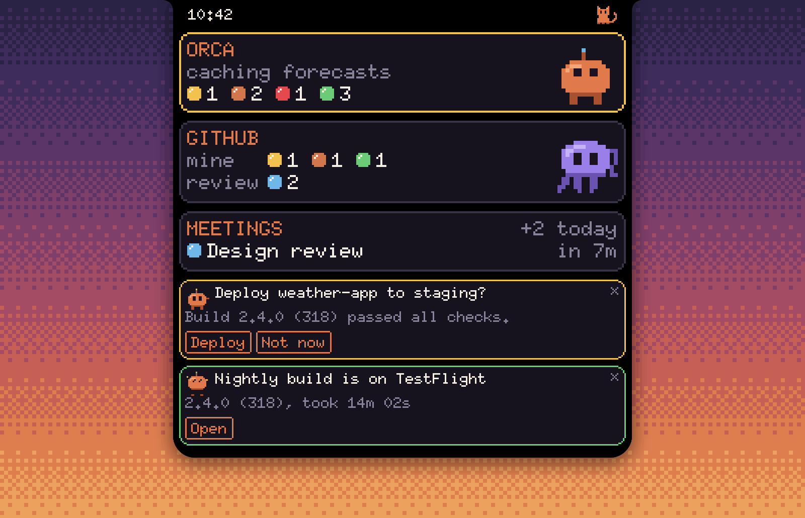
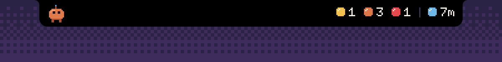
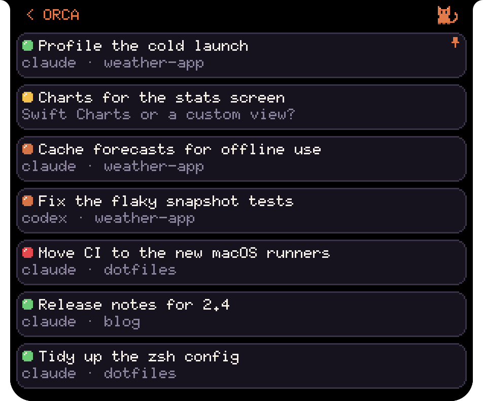
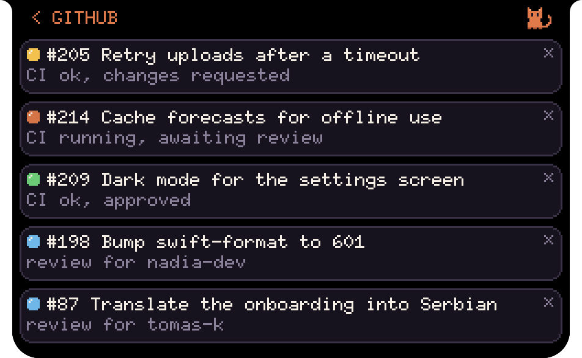
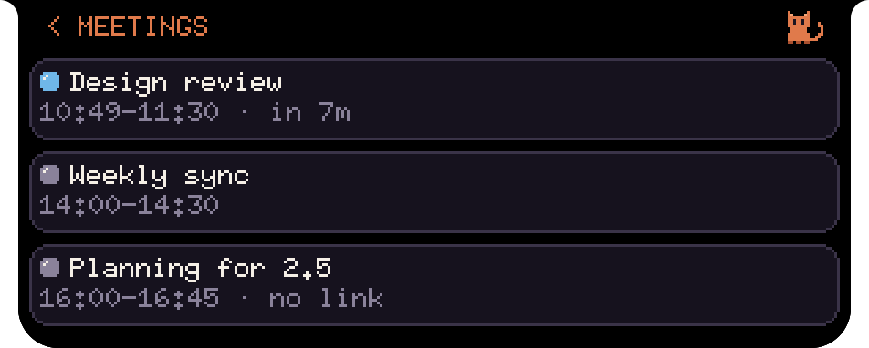
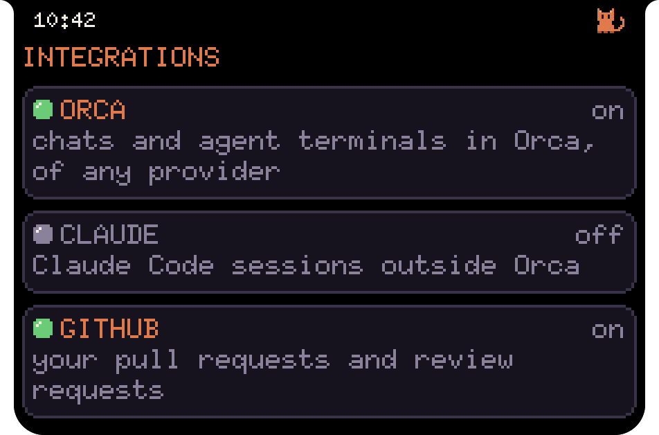
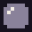

  

<h1 align="center">Pixeldeck</h1>

  A pixel status board in the MacBook notch. 
  It shows your Claude Code and Orca agents, pull requests and today's meetings. Scripts can post their own cards.

  
  
  
  

  

Rest the pointer on the notch and it opens into the board. Click a tile for its list, click a row to jump to the chat, pull request or call.

    scripts, hooks ──HTTP──┐
                           ├─► hub ◄── stream + clicks ──► notch
    Claude, agents ───MCP──┘

  

While something is going on, the closed notch grows wings. The left one holds the character. The right one counts agents that are running, waiting or failed, and shows the next meeting as `7m`, then `now`. A line of news drops under the notch for three seconds when:

- a card arrives,
- an agent finishes, fails or waits for you (`Pixeldeck finished`),
- your pull request is approved, fails CI or gets changes requested (`#412 Fix the build approved`),
- a meeting is five minutes away or starts (`Billing sync in 5m`).

<table>
  <tr>
    <td width="50%" valign="top"></td>
    <td width="50%" valign="top"></td>
  </tr>
  <tr>
    <td align="center">Orca chats, waiting ones first. A click opens the chat in Orca.</td>
    <td align="center">Your pull requests and the ones waiting for your review</td>
  </tr>
  <tr>
    <td valign="top"></td>
    <td valign="top"></td>
  </tr>
  <tr>
    <td align="center">Today's meetings. A click joins the call.</td>
    <td align="center">Integrations. A click switches one on or off.</td>
  </tr>
</table>

## Install

Pixeldeck needs macOS 15 or later.

1. Download `Pixeldeck.zip` from [Releases](../../releases), unzip it and move `Pixeldeck.app` to Applications. The app is not notarized, so macOS blocks the first launch. Allow it in System Settings → Privacy & Security → Open Anyway.
2. Right-click the notch, open Settings and click Connect next to the Pixeldeck plugin. This runs `claude`, so Claude Code has to be installed. Sessions started after that show up on the board. With a custom `CLAUDE_CONFIG_DIR`, run `claude plugin install pixeldeck --marketplace ~/.pixeldeck/claude-plugin` in Terminal with that variable set.
3. For the GITHUB tile, run `gh auth login`.
4. For MEETINGS, click Allow in Settings → Calendar. Pixeldeck reads the Calendar app, so a Google or Exchange account has to be added in System Settings → Internet Accounts.

The ORCA tile turns on by itself if Orca has run on this Mac.

To build from source you need Xcode:

    mac/install.sh     # build, copy to /Applications and start
    mac/package.sh     # build for Apple silicon and Intel into mac/build/Pixeldeck.zip

## Using it

The board closes when the pointer leaves and never takes focus from the app you are in. On a display without a notch it hangs from the middle of the menu bar.

- To go back from a list, swipe right or click its name beside the notch, such as `< ORCA`.
- Swipe right on the board for the integrations, left to come back.
- Pull down on the board or the GitHub list to ask GitHub right away, on the Orca list to ask Orca.
- Swipe an Orca chat left for its close button.

Mouse drags and two-finger trackpad swipes both work. The mouse wheel only scrolls.

There is no menu bar icon. Right-click the notch for the menu with the hub status, Settings and Quit. Settings has the integration switches, calendar access, the Claude Code plugin, the hub log and Launch at Login.

## Tiles

Each tile has a coloured light and a count per state. The feed under the tiles holds cards from scripts and agents. The cat beside the notch is orange while the hub answers and grey when it does not.

| Light | Agent | My pull request | Meeting |
| --- | --- | --- | --- |
|  | working | CI running | under way |
|  | waiting for you | changes requested | time to join, from 2 minutes before to 5 minutes after the start |
|  | finished | approved, CI green | |
|  | failed | CI failed | |
|  | | awaiting review | later today |
|  | | your review is requested | within 10 minutes |

**ORCA.** Every 3 seconds the hub asks Orca for its chats and agent terminals, whatever provider runs them. A waiting chat turns the tile border yellow. The list puts pinned tabs on top and waiting chats first, with the provider and project under each name (`claude · Pixeldeck`). Scheduled runs stay hidden unless they wait for you. A long swipe left closes a finished chat right away. A chat with a working or waiting agent closes only with the button, because closing it stops the agent.

Orca does not report the questions agents ask, so an `AskUserQuestion` shows only under Claude chats, where the plugin reports it. The hub talks to the same socket as the `orca` command. That API is internal to Orca and may break with an update; errors go to `~/.pixeldeck/hub.log`.

**CLAUDE.** The tile counts Claude Code sessions outside Orca and hides while there are none. Finished sessions stay for two minutes. You can't open or close them from the board. If Orca is off or not answering, its Claude sessions show here too.

The character sits on the top agent tile and reacts to sessions in both. It also shows the text from `set_status`.

**GITHUB.** Once a minute the hub asks `gh` for your open pull requests and review requests, drafts skipped. The octopus acts out the most urgent state: it blows bubbles while CI runs, waves at requested changes, goes red when CI fails, reads when your review is requested and looks pleased with an approval. The × on a row mutes it until its checks, review decision or title change.

**MEETINGS.** Once a minute the app reads today's events from the Calendar app. A meeting is an event you are invited to and have not declined, or your own event with a call link. All-day and cancelled events, colleagues' shared calendars, birthdays and subscribed calendars don't count. The tile shows the current or next meeting and how many are left today. A row opens the first Google Meet, Zoom or Teams link from the event's URL, location or notes. Rows without one say `no link`.

**Integrations.** Switch tiles on and off in the catalog or in Settings. The choice survives restarts. A switched-off ORCA or GITHUB stops asking for data. CLAUDE keeps tracking sessions and shows them again when switched back on. With nothing to show, the character plays short skits on the empty board.

## Cards

The hub takes requests only from this Mac and refuses those from browsers.

    curl 127.0.0.1:7777/cards -d '{
      "key": "pr-40405",
      "title": "PR #40405 needs review",
      "text": "CI is green",
      "sprite": "waiting",
      "actions": [
        {"label": "Open", "url": "https://github.com/..."},
        {"label": "Merge", "run": "merge-pr", "args": ["40405"]}
      ]
    }'

- `key` is optional. A card with the same key replaces the previous one.
- `sprite` sets the picture and the border colour: `idle`, `walk`, `thinking`, `waiting`, `done`, `error`, `alert`, `sleep`. A custom one is up to 32×32: `{"palette": {"a": "#ff0000"}, "frames": [["a.a", ".a."]], "fps": 4}`.
- A card has up to four actions. `url` opens in the browser, `run` starts an action from the config, `reply` answers whoever is waiting and removes the card.

| Request | What it does |
| --- | --- |
| `POST /cards` | create or replace a card |
| `GET /cards` | list cards |
| `DELETE /cards/:id` | remove a card |
| `GET /cards/:id/answer?timeout=60` | wait for a `reply` |
| `PUT /status` | set the character's mood: `{"mood": "thinking", "text": "...", "ttlSeconds": 1800}` |
| `PUT /integrations/:id` | switch `orca`, `claude` or `github`: `{"isOn": false}` |

Moods are `idle`, `thinking`, `waiting`, `done` and `error`. Any mood except `idle` resets after `ttlSeconds`.

## Actions

A card names an action, and the command lives in `~/.pixeldeck/actions.json`, so a card can't run arbitrary commands. The file is reread on every press.

    {
      "merge-pr": { "command": ["gh", "pr", "merge", "--squash"], "timeoutSeconds": 120 }
    }

`args` from the card are appended as separate arguments, without a shell.

## MCP

Claude Code gets the MCP server with the plugin. Other clients add it by hand:

    claude mcp add --transport http pixeldeck http://127.0.0.1:7777/mcp

Tools: `show_card`, `set_status`, `ask` (a question on the board that waits for a click), `remove_card`, `list_cards`.

## Privacy

- The hub listens only on `127.0.0.1:7777`.
- The Claude hook sends session events without prompts or tool output.
- Orca data comes from its local socket. Pinned tabs are read from Orca's `profile-state.db`, read-only.
- GitHub data comes from your `gh`.
- The app reads the calendar itself, and meetings never reach the hub.
- State, actions, muted pull requests, the log and a copy of the Claude plugin are in `~/.pixeldeck/`.

The app has no sandbox, because it runs `gh` and `claude`.

## Code

| Path | Contents |
| --- | --- |
| `mac/HubKit` | the hub: HTTP and MCP server, Orca, GitHub and Claude tracking. Tests: `cd mac/HubKit && swift test` |
| `mac/PixeldeckMac` | the app: Settings, calendar, starting and stopping the hub |
| `mac/PixeldeckMac/Notch` | the notch panel, wings and news line |
| `mac/PixeldeckMac/Board` | the board, drawn into small pixel buffers and scaled up without smoothing |
| `mac/ClaudePlugin` | the Claude Code plugin with the hook and MCP config. The app copies it to `~/.pixeldeck/claude-plugin` on every launch |
| `tools` | generators for the sprites, the font (X11 6×10, public domain), the icon and the lights in this README |

A new integration needs an entry in `Integration.catalog` in `Schema.swift`, a tile in `Board/Scene.swift` and a name in `SettingsView.swift`.

## License

MIT, see [LICENSE](LICENSE).
